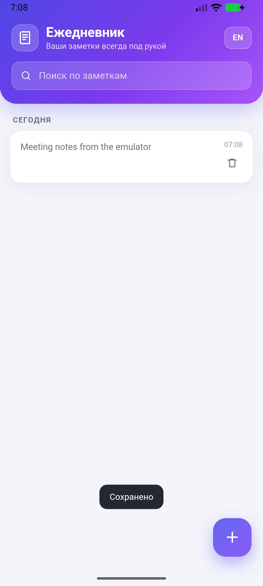
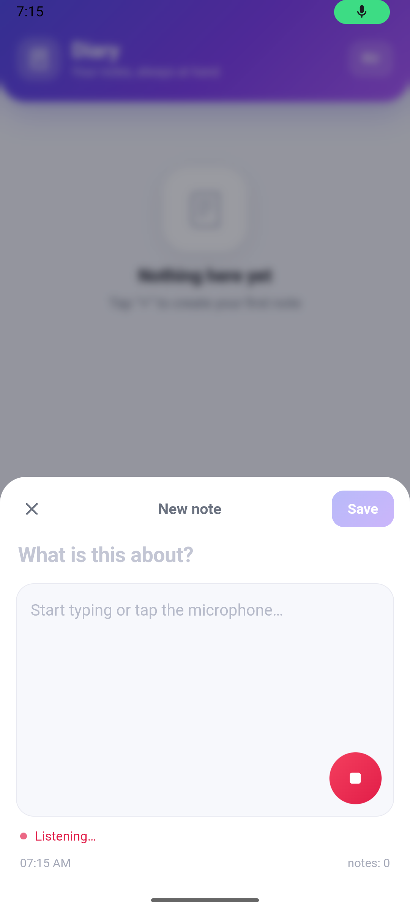
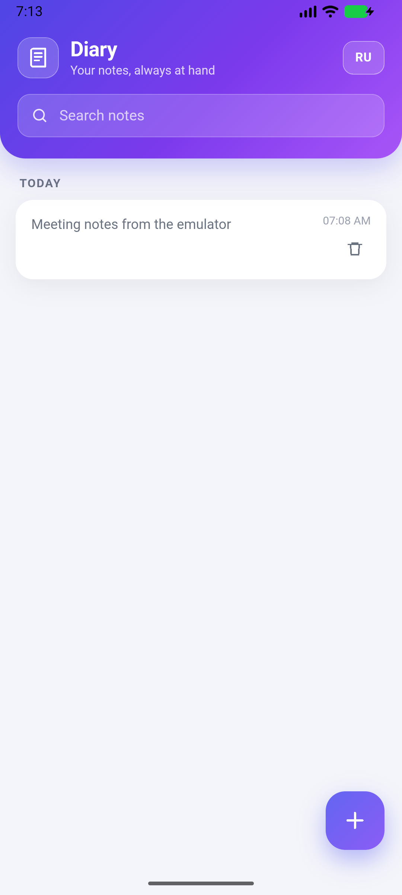

# Электронный ежедневник (Vue 3 + Capacitor)

Мобильное приложение-ежедневник: заметки создаются, редактируются и удаляются, хранятся локально на устройстве, есть голосовой ввод в поле содержания и переключение языка RU/EN.

| Список | Голосовой ввод | English |
|---|---|---|
|  |  |  |

## Что умеет

- список заметок с группировкой по дням (Сегодня/Вчера/дата) и поиском;
- создание, редактирование и удаление заметок;
- локальное хранение (Capacitor Preferences → Android SharedPreferences / localStorage в браузере) — заметки сохраняются между запусками;
- быстрый ввод: FAB «+» открывает шторку с полем содержания и кнопкой микрофона;
- голосовой ввод: нативный плагин `@capacitor-community/speech-recognition` на Android, Web Speech API в браузере; распознанный текст подставляется в поле содержания (частичные результаты видны сразу);
- интерфейс RU/EN, выбранный язык сохраняется.

## Стек

Vue 3 · Vite · Capacitor 8 · vue-i18n · Capacitor Preferences · @capacitor-community/speech-recognition.

## Запуск в браузере

```bash
npm install
npm run dev          # http://127.0.0.1:5173
```

Голосовой ввод в браузере работает в Chrome/Edge (Web Speech API) и требует разрешения на микрофон.

## Сборка и запуск на Android

Требования: JDK 17+ (проверено на JDK 21), Android SDK с platform-tools, build-tools 36 и платформой API 37.

```bash
npm run android:sync     # сборка веба + cap sync
npm run android:apk      # сборка APK -> android/app/build/outputs/apk/debug/app-debug.apk
```

Установка на запущенный эмулятор:

```bash
adb install -r android/app/build/outputs/apk/debug/app-debug.apk
adb shell am start -n com.diary.app/.MainActivity
```

Открыть проект в Android Studio:

```bash
npm run android:open
```

Эмулятор:

```bash
emulator -avd Medium_Phone_API_37.0
```

В Android Studio: **Device Manager → Medium_Phone_API_37.0 → ▶**, затем **Run 'app'**.

## Окружение этой машины

| Компонент | Состояние |
|---|---|
| Node.js / npm | 26.13.0 / 11.20.0 — установлены |
| Git | 2.56.0 — установлен |
| Android Studio | 2026.2.2 — установлена (`C:\Program Files\Android\Android Studio`) |
| Android SDK | `E:\Android` (platform-tools 37.0.1, build-tools 36.0.0, platform android-37.0, system-image android-37.0 google_apis_playstore x86_64) |
| AVD | `Medium_Phone_API_37.0` (Pixel-подобный, API 37, Play Store) |
| Ускорение | WHPX установлен и работает (`emulator-check accel` → ok) |
| JDK | на PATH был только JRE 1.8, поэтому скачан Temurin JDK 21 в `tools/jdk/jdk-21.0.13+9` |

Особенности:

- `winget` в этой сессии недоступен, JDK скачан напрямую с adoptium.net.
- Android SDK доступен только на чтение, поэтому в проекте зафиксированы `compileSdk 37` и `buildToolsVersion 36.0.0` (`android/variables.gradle`), а библиотечные модули Capacitor получают ту же версию build-tools из `android/build.gradle`.
- Debug-сборка подписывается локальным ключом `android/keystore/debug.keystore` (пароль `android`), чтобы не зависеть от `~/.android/debug.keystore`.

### Переменные окружения

`ANDROID_HOME`, `ANDROID_SDK_ROOT` и `JAVA_HOME` не были прописаны в системе. Скрипт:

```powershell
powershell -ExecutionPolicy Bypass -File .\scripts\setup-env.ps1
```

или вручную в текущей сессии:

```powershell
$env:ANDROID_HOME='E:\Android'
$env:JAVA_HOME='E:\DIarryApp\tools\jdk\jdk-21.0.13+9'
$env:GRADLE_USER_HOME='E:\DIarryApp\.gradle'
$env:PATH="$env:JAVA_HOME\bin;$env:ANDROID_HOME\platform-tools;$env:ANDROID_HOME\emulator;$env:PATH"
```

## Голосовой ввод

- Android: `SpeechRecognition.start({ partialResults: true })`; текст добавляется в конец поля содержания, частичные результаты обновляются на лету.
- Разрешение `RECORD_AUDIO` объявлено в `android/app/src/main/AndroidManifest.xml`, сервис распознавания — в блоке `<queries>`.
- Если на устройстве нет сервиса распознавания речи, показывается сообщение «Голосовой ввод недоступен».
- Запись можно остановить повторным нажатием на микрофон; через 30 секунд она останавливается автоматически.

## Структура

```
src/
  App.vue        — экран списка, шторка быстрого ввода/редактирования
  storage.js     — обёртка над Capacitor Preferences (JSON)
  voice.js       — нативный плагин + Web Speech API
  i18n.js        — сообщения RU/EN
  style.css      — оформление
android/         — нативный проект Capacitor
scripts/         — вспомогательные скрипты окружения
docs/            — скриншоты
```

## Проверка на эмуляторе

1. Запустить эмулятор и дождаться загрузки (`adb wait-for-device`, `adb shell getprop sys.boot_completed` → `1`).
2. Установить APK и открыть приложение.
3. Нажать «+», ввести текст, нажать микрофон (разрешить доступ к микрофону при запросе) — текст появится в поле содержания.
4. Сохранить заметку, перезапустить приложение — заметка на месте.

Проверено на эмуляторе: создание, сохранение, перезапуск, редактирование, удаление, переключение RU/EN, запуск нативного распознавания речи (`RecognitionServiceImpl` получает запрос, микрофон открывается, UI показывает «Слушаю…»).
