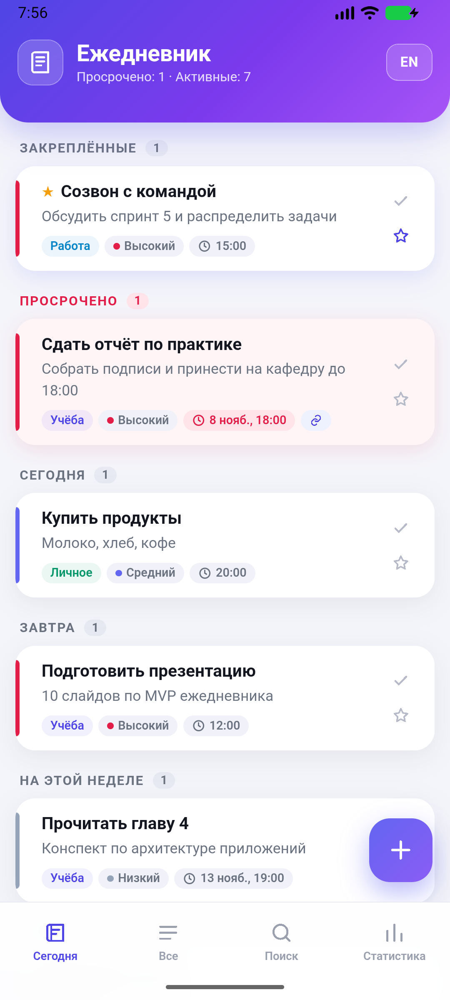
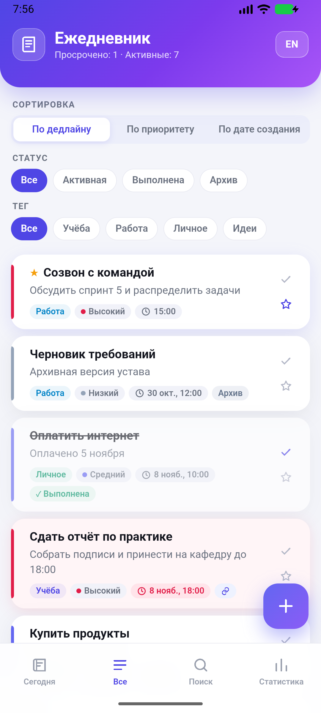
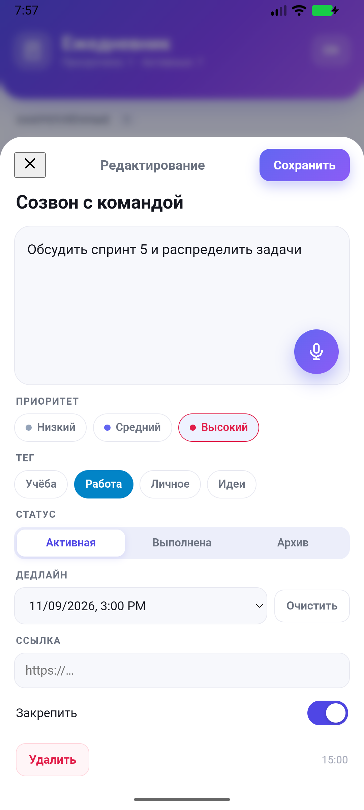
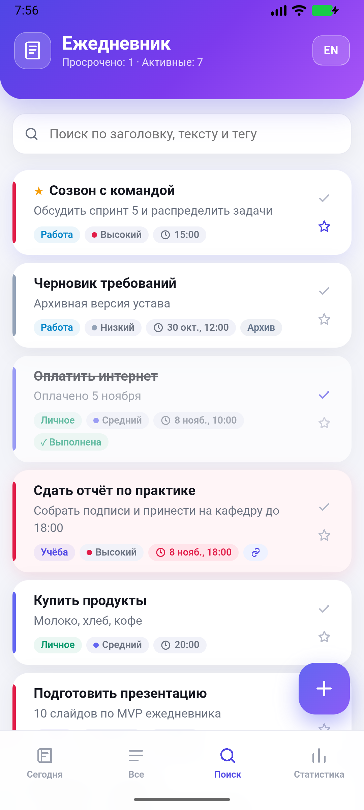
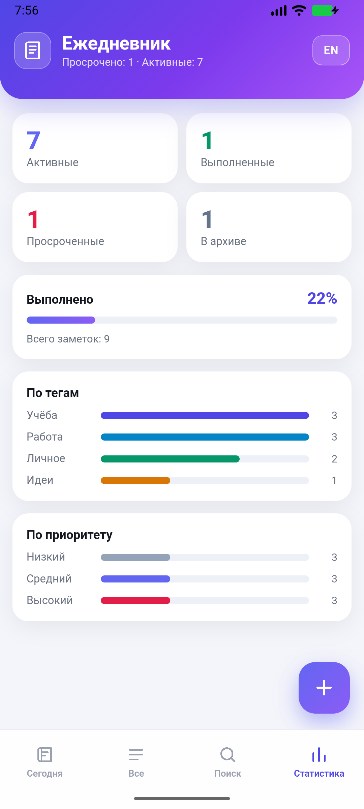
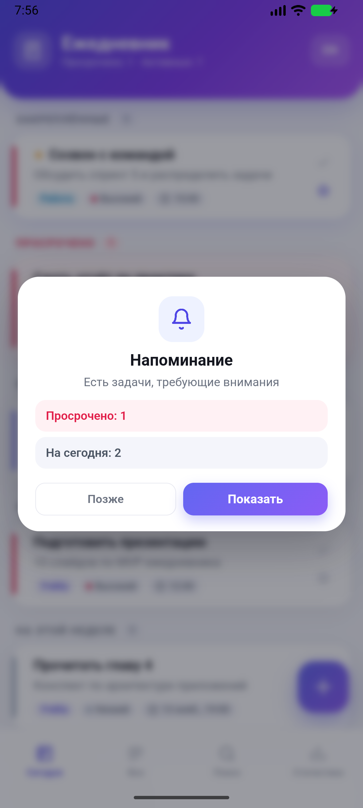
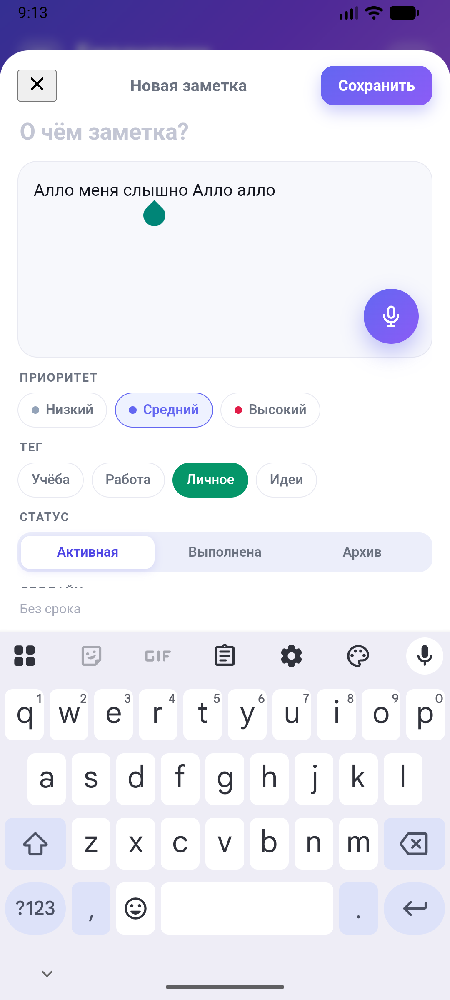

**Репозиторий:** https://github.com/matvey24358952-stack/e-diary

# Электронный ежедневник

Мобильное приложение-ежедневник по уставу проекта: заметки с тегами, приоритетами, дедлайнами и статусами, поиск, фильтры, группировка по датам, напоминания и статистика. Работает полностью локально, без сервера и авторизации.

**Стек:** Vue 3 · Vite · Capacitor 8 · vue-i18n · Capacitor Preferences · Capacitor Local Notifications · `@capacitor-community/speech-recognition`.

| Сегодня | Все заметки | Редактор |
|---|---|---|
|  |  |  |

| Поиск | Статистика | Напоминание при запуске |
|---|---|---|
|  |  |  |

## Документы проекта

- [`docs/Отчёт_по_проекту_Электронный_ежедневник.docx`](docs/Отчёт_по_проекту_Электронный_ежедневник.docx) — отчёт по MVP: требования, архитектура, модель данных, экраны, голос, напоминания, тестирование, пустой раздел под iOS.
- [`docs/Руководство_пользователя_Электронный_ежедневник.docx`](docs/Руководство_пользователя_Электронный_ежедневник.docx) — как запускать и пользоваться приложением.
- [docs/Техническое_описание_Электронный_ежедневник.docx](docs/Техническое_описание_Электронный_ежедневник.docx) — как устроен код: архитектура, алгоритмы, голосовой ввод, сборка и найденные проблемы.
- [`docs/Презентация_Электронный_ежедневник.pptx`](docs/Презентация_Электронный_ежедневник.pptx) — презентация для демонстрации (12 слайдов).
## Возможности (MVP по уставу)

- **Заметки:** создание, редактирование, удаление; поля — заголовок, текст, тег, приоритет, дедлайн, статус, URL-ссылка, закрепление.
- **Теги:** учёба, работа, личное, идеи. По умолчанию «личное», чипсы тегов в карточке и в редакторе.
- **Приоритеты:** низкий, средний, высокий (по умолчанию средний), цветовая полоса слева в карточке.
- **Дедлайны:** дата и время; просроченные активные заметки подсвечиваются красным.
- **Статусы:** активная, выполнена, архив (по умолчанию активная).
- **Закрепление:** закреплённые заметки всегда в отдельной группе сверху.
- **Ссылка:** URL-вложение (файлы по уставу не поддерживаются).
- **Группировка:** «Закреплённые», «Просрочено», «Сегодня», «Завтра», «На этой неделе», «Позже».
- **Сортировка:** по дедлайну, по приоритету, по дате создания.
- **Фильтры:** по статусу и по тегу.
- **Поиск:** по заголовку, тексту и тегу.
- **Напоминания:** диалог при запуске (просрочено / на сегодня) и локальные уведомления к дедлайну.
- **Статистика:** активные, выполненные, просроченные, архив, процент выполнения, разрезы по тегам и приоритетам.
- **Голосовой ввод** в поле содержания (нативный плагин на Android, Web Speech API в браузере).

Язык диктовки переключается кнопкой **RU / EN** слева от микрофона и не зависит от языка интерфейса: если интерфейс английский, а говорите вы по-русски, нажмите **RU** — выбор сохранится.
- **Локализация RU/EN** с сохранением выбранного языка.

## Модель заметки

```json
{
  "id": "1794210477977-ab12cd",
  "title": "Сдать отчёт по практике",
  "content": "Собрать подписи и принести на кафедру",
  "tag": "study",
  "priority": "high",
  "status": "active",
  "due": 1794160800000,
  "pinned": false,
  "url": "https://university.example/practice",
  "createdAt": 1794210477977,
  "updatedAt": 1794209997977
}
```

Хранение — Capacitor Preferences (JSON-массив в Android SharedPreferences / localStorage в браузере). Заметки старого формата мигрируют при загрузке: `normalizeNote` подставляет приоритет «средний», статус «активная», тег «личное», `due = null`.

## Экраны

- **Сегодня** — закреплённые и задачи по датам; чек-бокс отмечает выполнение, звезда закрепляет.
- **Все заметки** — сортировка и фильтры по статусу и тегу.
- **Поиск** — строка поиска по заголовку, тексту и тегу.
- **Статистика** — счётчики и графики.
- **Редактор** (шторка) — все поля заметки, микрофон, удаление.
- Нижняя навигация из четырёх вкладок, FAB «+» для быстрого создания.

## Напоминания

- При запуске показывается диалог со счётчиками просроченных и задач на сегодня.
- Нативные уведомления планируются на дедлайн (`@capacitor/local-notifications`, канал `reminders`), список пересобирается при каждом изменении заметок.
- Разрешения: `POST_NOTIFICATIONS` (запрашивается системой при первом планировании), `USE_EXACT_ALARM` (выдаётся при установке — приложение не отправляет пользователя в настройки будильников), `VIBRATE`.
- Если уведомления запрещены, приложение продолжает работать, остаётся диалог при запуске.

## Запуск

```bash
npm install
npm run dev            # http://127.0.0.1:5173
```

### Самый простой запуск на эмуляторе (без Android Studio)

```powershell
powershell -ExecutionPolicy Bypass -File .\scripts\run-android.ps1
```

Скрипт выставляет JDK/SDK/Gradle, собирает APK, ставит его на подключённый эмулятор и открывает приложение.

Сборка Android:

```bash
npm run android:sync   # vite build + cap sync android
npm run android:apk    # APK -> android/app/build/outputs/apk/debug/app-debug.apk
```

Установка на эмулятор/устройство:

```bash
adb install -r app-debug.apk
adb shell am start -n com.diary.app/.MainActivity
```

Готовая сборка лежит в корне: [`app-debug.apk`](app-debug.apk).

Android Studio: открыть папку `android` (не корень проекта) и нажать Run. Либо `npm run android:open`.

Эмулятор: `emulator -avd Medium_Phone_API_37.0`.

## Окружение этой машины

| Компонент | Состояние |
|---|---|
| Node.js / npm | 26.13.0 / 11.20.0 |
| Git | 2.56.0 |
| Android Studio | 2026.2.2 (`C:\Program Files\Android\Android Studio`) |
| Android SDK | `E:\Android`: platform-tools 37.0.1, build-tools 36.0.0, platform android-37.0, образ android-37.0 google_apis_playstore x86_64 |
| AVD | `Medium_Phone_API_37.0` (Play Store, x86_64) |
| Ускорение | WHPX работает |
| JDK | Temurin 21 в `tools/jdk/jdk-21.0.13+9` (на PATH был только JRE 1.8) |

Особенности:

- `winget` в сессии недоступен — JDK скачан напрямую с adoptium.net.
- Android SDK доступен только на чтение, поэтому в `android/variables.gradle` зафиксированы `compileSdk 37` и `buildToolsVersion 36.0.0`; библиотечные модули Capacitor получают ту же версию из `android/build.gradle`.
- Debug-подпись — локальный ключ `android/keystore/debug.keystore` (пароль `android`), чтобы сборка не зависела от `~/.android/debug.keystore`.
- Gradle JDK для Android Studio задан в `android/.gradle/config.properties` (`java.home` → JDK 21), иначе студия берёт встроенный JBR 25, несовместимый с Gradle 8.14.3.
- Java на этой машине не может писать в `C:\Users\matve`, поэтому кэш Gradle и дистрибутив лежат в `E:\DIarryApp\.gradle`, а переменная `GRADLE_USER_HOME` указывает туда (её выставляет `scripts/setup-env.ps1`). Без неё Android Studio падает с «Unable to start the daemon process».

### Android Studio

1. `File → Open` → папка `E:\DIarryApp\android` (именно `android`, не корень).
2. Убедиться, что в `Settings → Build, Execution, Deployment → Build Tools → Gradle` выбран JDK 21 (проект подставляет его сам).
3. Нажать **Sync Project with Gradle Files** — синхронизация проходит без загрузок, из локального кэша.
4. В списке устройств выбрать запущенный `Medium_Phone_API_37.0` и нажать **Run 'app'**.

Переменные окружения:

```powershell
powershell -ExecutionPolicy Bypass -File .\scripts\setup-env.ps1
```

или в текущей сессии:

```powershell
$env:ANDROID_HOME='E:\Android'
$env:JAVA_HOME='E:\DIarryApp\tools\jdk\jdk-21.0.13+9'
$env:GRADLE_USER_HOME='E:\DIarryApp\.gradle'
$env:PATH="$env:JAVA_HOME\bin;$env:ANDROID_HOME\platform-tools;$env:ANDROID_HOME\emulator;$env:PATH"
```

## Структура

```
src/
  App.vue                    — оболочка: вкладки, FAB, диалог напоминаний, обработка «Назад»
  components/
    NotesView.vue            — режимы «Сегодня» / «Все» / «Поиск», фильтры и сортировка
    NoteCard.vue             — карточка заметки
    NoteEditor.vue           — редактор со всеми полями и микрофоном
    StatsView.vue            — статистика
    BottomNav.vue            — нижняя навигация
  utils/notes.js             — нормализация, группировка, сортировка, статистика
  storage.js                 — Capacitor Preferences
  notifications.js           — локальные уведомления к дедлайну
  voice.js                   — нативный плагин + Web Speech API
  i18n.js                    — RU/EN
  style.css                  — оформление
android/                     — нативный проект Capacitor
scripts/setup-env.ps1        — переменные окружения
docs/                        — скриншоты
```

## Проверено на эмуляторе

- создание заметки со всеми полями, сохранение и загрузка после `force-stop` и перезапуска;
- группировка «Закреплённые / Просрочено / Сегодня / Завтра / На этой неделе / Позже», красная подсветка просроченных;
- смена статуса на «Выполнена» убирает заметку из «Сегодня» и обновляет статистику;
- фильтры по статусу и тегу, сортировка по дедлайну/приоритету/дате создания;
- поиск по тексту (проверен запрос «отчёт»);
- диалог напоминания при запуске с корректными счётчиками;
- локальное уведомление к дедлайну реально пришло в системный трей (`NotificationRecord ... channel=reminders`);
- голосовой ввод на эмуляторе: нажатие микрофона открывает системный диалог Google, произнесённая фраза попадает в поле содержания (нужен запуск через `scripts/start-emulator.ps1`, см. ниже);
- переключение RU/EN сохраняется между запусками.

## Ограничения

- Вложения-файлы не поддерживаются — только URL (по уставу).
- Поле дедлайна использует системный `datetime-local`, поэтому формат даты зависит от локали устройства.
- Авторизации нет: данные хранятся только на устройстве.

## Если что-то не работает

### Голосовой ввод на эмуляторе молчит

На этой машине микрофон хоста не доходит до Android с аудиобэкендом по умолчанию: распознавание стартует, но получает тишину. Рабочая комбинация — принудительный **dsound** и запуск с окном:

```powershell
powershell -ExecutionPolicy Bypass -File .\scripts\start-emulator.ps1
```

Скрипт выставляет `QEMU_AUDIO_DRV=dsound` и `QEMU_AUDIO_IN_DRV=dsound`, запускает AVD с окном и ждёт загрузки. Эти же переменные прописаны в профиль пользователя, так что обычный запуск `emulator -avd Medium_Phone_API_37.0` из нового терминала тоже подхватит их.

Проверено: после запуска с dsound в приложении на эмуляторе нажатие микрофона открывает системный диалог Google, и произнесённая фраза попадает в поле содержания.

| Голос на эмуляторе |
|---|
|  |

Если текста нет:

1. В окне эмулятора: «…» (Extended Controls) → **Microphone** → включить **Virtual microphone uses host audio input**.
2. В Windows микрофон по умолчанию: **Параметры → Система → Звук → Ввод** (не виртуальные Waves SoundGrid / NVIDIA).
3. Нажать микрофон, дождаться диалога Google, сказать фразу и помолчать 1–2 секунды — диалог сам вернёт текст.

В браузере (Chrome/Edge) используется Web Speech API и микрофон компьютера — там эмулятор не нужен. Важно открывать именно `http://127.0.0.1:5173`: разрешение на микрофон в браузере привязано к адресу, поэтому в `vite.config.js` включён `strictPort`, чтобы Vite не уезжал на 5174/5175.

### Не запускается из Android Studio

1. Убедитесь, что открыта папка `E:\DIarryApp\android`, а не корень проекта.
2. `File → Sync Project with Gradle Files` должен завершиться без ошибок (см. раздел про окружение).
3. В списке устройств выберите запущенный эмулятор и нажмите **Run 'app'**; если конфигурация не создалась, выберите **Edit Configurations → + → Android App → module: app**.
4. Если студия капризничает — используйте `scripts\run-android.ps1`, он делает то же самое из командной строки.
